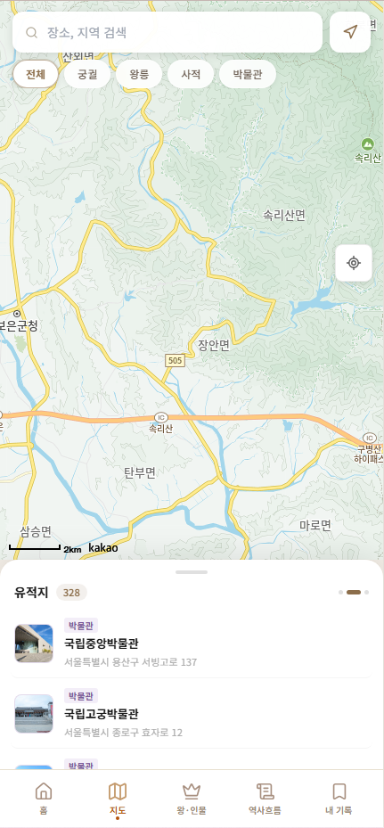
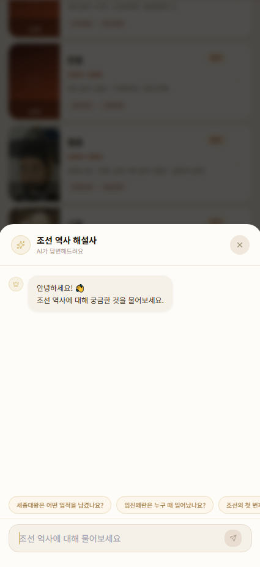
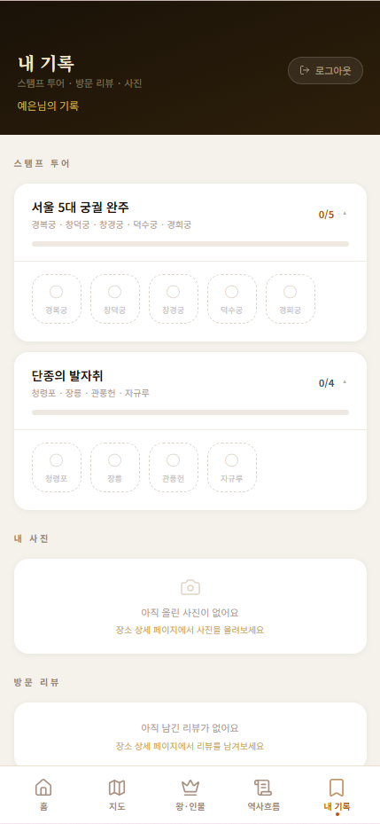
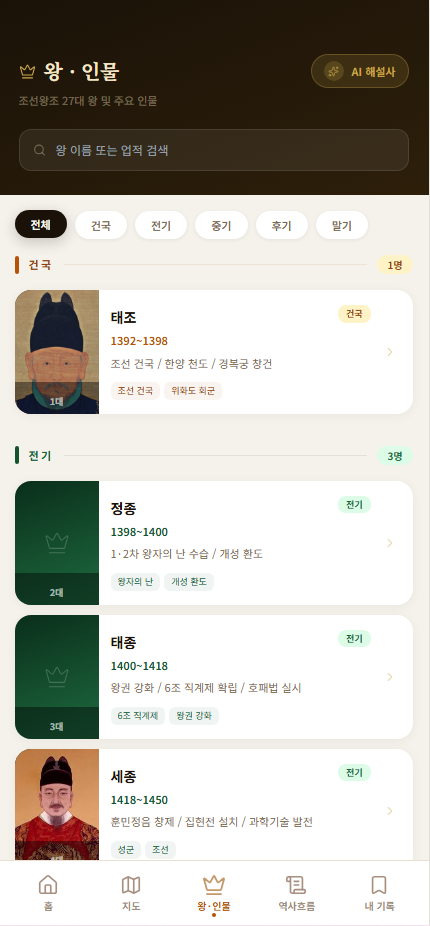
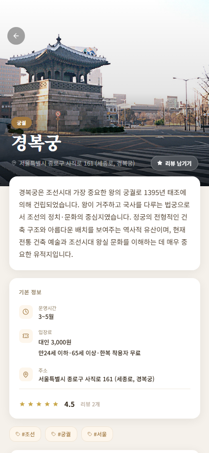
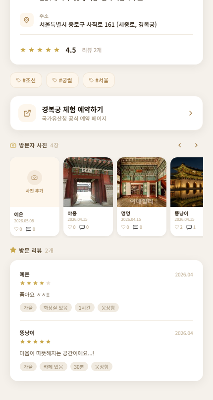
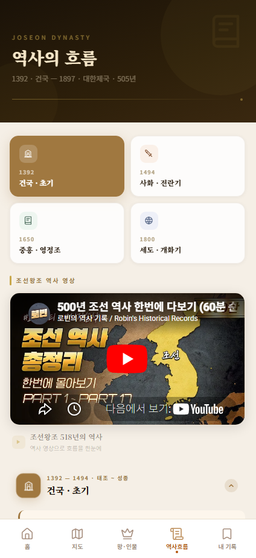

# 조선로그 (JoseonLog)

> 조선시대 역사 문화유산을 지도 기반으로 탐방하는 역사 문화 PWA

---

## 목차

1. [프로젝트 소개](#1-프로젝트-소개)
2. [주요 기능](#2-주요-기능)
3. [기술 스택](#3-기술-스택)
4. [프로젝트 구조](#4-프로젝트-구조)
5. [실행 방법](#5-실행-방법)
6. [데이터 수집 및 정제 과정](#6-데이터-수집-및-정제-과정)
7. [DB 테이블 구조](#7-db-테이블-구조)
8. [스크린샷](#8-스크린샷)

---

## 1. 프로젝트 소개

### 기획 배경

국내에는 경복궁·창덕궁과 같은 조선 5대 궁궐, 40곳이 넘는 왕릉, 수백 개의 사적지가 산재해 있지만 이를 한 곳에서 통합적으로 탐색할 수 있는 서비스가 없었습니다. 기존 문화재 안내 앱은 특정 기관 한정 정보를 제공하거나 지도 연동이 부족하고, 방문 기록을 남기는 기능이 없어 지속적인 탐방 동기를 부여하기 어렵습니다.

**조선로그**는 이런 문제를 해결하기 위해:

- 공공 API · 웹 크롤링 · 수동 입력을 결합해 **궁궐·종묘·왕릉·사적지·박물관** 데이터를 하나의 DB에 통합
- **지도 기반 탐색 + AI 챗봇 + 스탬프 투어** 를 결합해 역사 콘텐츠를 능동적으로 소비할 수 있는 경험을 제공
- 모바일 환경에서도 설치·오프라인 사용이 가능한 **PWA(Progressive Web App)** 로 구현

데이터 분석가의 관점에서, 수집-정제-적재-서빙의 전 과정을 직접 설계·구현한 **데이터 파이프라인 프로젝트**이기도 합니다.

---

## 2. 주요 기능

### 지도 탐방
카카오맵 API 기반의 인터랙티브 지도에서 궁궐·왕릉·사적지·박물관을 카테고리별로 마커로 표시합니다. 마커 클릭 시 장소 상세 정보(설명, 이미지, 운영시간, 입장료)를 확인할 수 있으며, 사용자 리뷰와 사진 갤러리도 연동됩니다.

### AI 역사 챗봇
RAG(Retrieval-Augmented Generation) 방식의 조선 역사 전문 챗봇입니다. 사용자 질문과 의미적으로 유사한 문서를 ChromaDB에서 검색(`jhgan/ko-sroberta-multitask` 한국어 임베딩 모델)해 Claude API에 컨텍스트로 제공하고, 스트리밍으로 응답을 반환합니다.

### 스탬프 투어
사전에 구성된 탐방 코스를 따라 장소를 방문하고 스탬프를 적립하는 게임형 기능입니다. 유저별 스탬프 달성 현황을 추적하고, 완료 시 전체 코스 달성을 기록합니다.

### 데이터 대시보드 (기록 페이지)
내가 방문한 장소, 남긴 리뷰, 스탬프 현황을 한눈에 볼 수 있는 개인 기록 페이지입니다.

### 조선 왕 타임라인
조선 27대 왕의 재위 기간을 시대(건국·초기·중기·후기·말기)별로 정렬한 타임라인입니다. 왕 카드를 클릭하면 생몰년, 재위 기간, 주요 업적, 연관 능·사적지로 이동할 수 있습니다.

---

## 3. 기술 스택

| 영역 | 기술 |
|------|------|
| **프론트엔드** | React 18, Vite 5, TailwindCSS 3, React Router v6, Axios |
| **PWA** | vite-plugin-pwa (Workbox) |
| **지도** | 카카오맵 JavaScript API |
| **백엔드** | FastAPI, Uvicorn |
| **ORM / DB** | SQLAlchemy, MySQL (PyMySQL) |
| **인증** | 카카오 OAuth 2.0, 구글 OAuth 2.0, JWT (python-jose) |
| **AI 챗봇** | Anthropic Claude API (claude-sonnet-4), 스트리밍 응답 |
| **RAG** | ChromaDB (벡터 스토어), jhgan/ko-sroberta-multitask (한국어 임베딩) |
| **데이터 수집** | Python requests, BeautifulSoup4, pandas, EasyOCR / PaddleOCR |
| **좌표 보정** | 카카오 로컬 API (주소·키워드 기반 지오코딩) |

---

## 4. 프로젝트 구조

```
history/
├── joseon-back/                # FastAPI 백엔드
│   ├── main.py                 # 앱 진입점, 라우터 등록
│   ├── database.py             # SQLAlchemy 엔진·세션
│   ├── models.py               # ORM 모델 (User, Place, King, Stamp ...)
│   ├── schemas.py              # Pydantic 스키마
│   ├── auth.py                 # JWT 발급·검증
│   ├── routers/
│   │   ├── auth_router.py      # 카카오·구글·로컬 로그인
│   │   ├── places_router.py    # 장소 목록·상세 조회
│   │   ├── kings_router.py     # 왕 목록·상세 조회
│   │   ├── reviews_router.py   # 리뷰 CRUD
│   │   ├── stamps_router.py    # 스탬프 투어 관리
│   │   ├── photos_router.py    # 장소 사진 업로드·좋아요·댓글
│   │   └── ai_router.py        # RAG 챗봇 (스트리밍)
│   ├── rag/
│   │   ├── load_data.py        # joseon.md → ChromaDB 임베딩
│   │   └── retriever.py        # 유사도 검색 (ko-sroberta)
│   ├── data/
│   │   ├── joseon.csv          # 챗봇용 조선 역사 지식 베이스
│   │   └── joseon.md
│   ├── chroma_db/              # ChromaDB 벡터 저장소
│   ├── uploads/photos/         # 사용자 업로드 이미지
│   └── requirements.txt
│
├── joseon-pwa/                 # React PWA 프론트엔드
│   ├── src/
│   │   ├── App.jsx             # 라우팅 설정
│   │   ├── main.jsx
│   │   ├── api/api.js          # Axios 인스턴스·API 함수
│   │   ├── context/
│   │   │   └── AuthContext.jsx # 전역 인증 상태
│   │   ├── components/
│   │   │   └── common/
│   │   │       └── BottomNav.jsx
│   │   └── pages/
│   │       ├── HomePage.jsx
│   │       ├── MapPage.jsx             # 카카오맵 탐방
│   │       ├── KingsPage.jsx           # 왕 타임라인
│   │       ├── KingDetailPage.jsx
│   │       ├── PlaceDetailpage.jsx
│   │       ├── PlacePhotoGalleryPage.jsx
│   │       ├── TimelinePage.jsx
│   │       ├── RecordPage.jsx          # 개인 기록 대시보드
│   │       ├── LoginPage.jsx
│   │       ├── SignupPage.jsx
│   │       ├── KakaoCallbackPage.jsx
│   │       └── GoogleCallbackPage.jsx
│   ├── public/icons/
│   ├── package.json
│   └── vite.config.js
│
└── joseon-data/                # 데이터 수집·정제 파이프라인
    ├── collectors/
    │   ├── heritage_collector.py       # 문화재청 API → 궁궐·종묘
    │   ├── heritage_sites_collector.py # 국가유산청 API → 사적지
    │   ├── kings_tombs_extractor.py    # 왕릉 수동 입력 (48개)
    │   ├── kings_crawler.py            # 한국민족문화대백과 링크 수집
    │   ├── kings_data.py               # 왕 상세 크롤링
    │   ├── kings_birth_death.py        # 생몰년 보완
    │   └── museums_data.py             # 공공데이터포털 API → 박물관
    ├── normalize_data/
    │   ├── normalize.py                # 스키마 통일·ID 부여
    │   ├── insert.py                   # MySQL 적재
    │   ├── insert_kings.py
    │   ├── normalized_palaces.json
    │   ├── normalized_sites.json
    │   └── normalized_tombs.json
    ├── data/
    │   ├── heritages_data/
    │   │   ├── palaces_jongmyo/        # 궁궐·종묘 수집 결과
    │   │   ├── historic_sites/         # 사적지 수집 결과
    │   │   ├── royal_tombs/            # 왕릉 데이터
    │   │   └── museums/                # 박물관 데이터
    │   └── kings_data/                 # 왕 정보 수집 결과
    ├── assets/
    │   └── 조선왕계도.pdf              # OCR 시도 원본 자료
    ├── geocode_fill.py                 # 카카오 API 좌표·주소 보정
    └── summarize_places.py             # 장소 설명 요약 생성
```

---

## 5. 실행 방법

### 사전 요구사항

- Python 3.10+
- Node.js 18+
- MySQL 8.0+

### 백엔드

```bash
cd joseon-back

# 가상환경 설정
python -m venv .venv
source .venv/Scripts/activate   # Windows
# source .venv/bin/activate     # macOS/Linux

# 패키지 설치
pip install -r requirements.txt

# 환경변수 설정
cp .env.example .env
# .env에 DB_HOST, DB_USER, DB_PASSWORD, DB_NAME, CLAUDE_API_KEY,
# KAKAO_CLIENT_ID, GOOGLE_CLIENT_ID, SECRET_KEY 입력

# ChromaDB 벡터 임베딩 로드 (최초 1회)
python rag/load_data.py

# 서버 실행
uvicorn main:app --reload --port 8000
```

### 프론트엔드

```bash
cd joseon-pwa

# 패키지 설치
npm install

# 환경변수 설정
cp .env.example .env
# .env에 VITE_API_URL, VITE_KAKAO_MAP_KEY, VITE_KAKAO_CLIENT_ID,
# VITE_GOOGLE_CLIENT_ID 입력

# 개발 서버 실행
npm run dev

# 프로덕션 빌드
npm run build
```

---

## 6. 데이터 수집 및 정제 과정

이 프로젝트의 핵심은 **분산된 공공 데이터를 하나의 일관된 스키마로 통합**하는 파이프라인입니다. 소스별로 API 구조·응답 포맷·좌표 품질이 상이해 각 단계마다 별도의 정제 전략을 적용했습니다.

---

### 6-1. 궁궐·종묘 — 문화재청 Open API

**수집 대상:** 경복궁, 창덕궁, 창경궁, 덕수궁, 종묘 (5개소 전체 전시·공간 정보)

**수집 방법:**

문화재청 궁궐 Open API(`heritage.go.kr`)는 **목록 API**와 **상세 API** 두 단계로 구성됩니다. 목록 API에서 `serial_number`, `detail_code`를 수집하고, 상세 API로 개별 공간의 설명(`explanation_kor`)과 이미지 URL을 보완하는 2-pass 방식을 채택했습니다.

```
목록 API (gung_number 1~5 순회)
    └─ name, description, image_url 모두 존재 → 즉시 수집
    └─ 일부 필드 누락 → 상세 API 추가 호출로 보완
```

**정제 내용:**

- 빈 이름(`name`) 행 제거
- `serial_number + gung_number` 기준 중복 제거
- 좌표(`lat`, `lng`)는 API 미제공 → 카카오 로컬 API로 후처리 (§6-6 참조)
- 결측값 현황을 수집 단계에서 로그로 출력해 추후 보완 항목 명확화

**출력:** `palaces_raw.json`, `palaces_clean.csv`

---

### 6-2. 사적지 — 국가유산청 Open API

**수집 대상:** 종목코드 13(사적), 14(사적및명승) 중 **조선시대** 해당 항목

**수집 방법:**

국가유산청 API(`khs.go.kr`)는 전국 코드(`ZZ`)가 동작하지 않아 **17개 시도코드를 순회**하며 페이지네이션 수집을 구현했습니다.

```
시도코드 17개 × [목록 → 상세 → 이미지] 3-pass 수집
    └─ 상세 API의 ccceName(시대) 필드에서 "조선" 포함 여부로 필터링
    └─ 이미지 URL 없는 경우 별도 이미지 API 추가 호출
```

**정제 내용:**

- `lat/lng`가 `"0"` 또는 `"0.0"` 인 경우 `None`으로 처리 (오류 좌표 제거)
- HTML 태그 포함된 `content` 필드를 정규식으로 정제, 60자 이내 요약 문장 추출
- 사적지 이름·카테고리명 기반 자동 태그 생성: 지역, 카테고리, 유네스코 여부, 산성·서원·향교·행궁 등 속성 태그

**출력:** `historic_sites/sites.json`, `historic_sites/sites.csv`

---

### 6-3. 왕릉 — OCR 시도 후 수동 입력 (48개)

**수집 경위와 의사결정 과정:**

왕릉 데이터는 문화재청 및 국가유산청 API에서 개별 능(陵)의 위치·관할 정보를 체계적으로 제공하지 않았습니다. 이에 처음에는 **PDF 형태의 조선왕계도**(`assets/조선왕계도.pdf`)에서 OCR로 정보를 추출하는 방법을 시도했습니다.

```
1차 시도: EasyOCR → 한자·표 구조 인식률 낮음, 능호·주소 혼재
2차 시도: PaddleOCR → 표 인식 개선되었으나 지명 오인식 다수
결론: OCR 후처리 비용 > 수동 입력 비용 → 수동 입력으로 전환
```

**수동 입력 기준:**

문화재청 조선왕릉 공식 안내 페이지와 국가유산청 자료를 기준으로, 조선 1대(태조)부터 27대(순종)까지의 능·원·묘, 추존 왕릉, 대한제국 황릉을 포함해 **48개 항목**을 직접 입력했습니다.

| 필드 | 설명 |
|------|------|
| `order` | 대수 (예: `1대`, `추존`, `대한제국`) |
| `name` | 능주 (능에 안장된 왕·왕비) |
| `tomb_name` | 능호 (예: `건원릉`, `영릉`) |
| `address` | 실제 주소 (북한 소재 능은 `"북한"` 처리) |
| `heritage_name` | 관할 사적지명 (예: `구리 동구릉`) |
| `phone` | 관리소 전화번호 |

**특이 처리:**

- 북한 소재 능(제릉, 후릉): 좌표 수집 불가로 `address = "북한"`, `lat/lng = null` 유지
- 동일 능호에 여러 능주가 있는 경우(합장·쌍릉) 각각 별도 행으로 분리

**출력:** `royal_tombs/royal_tombs.csv`, `royal_tombs/royal_tombs.json` (48개)

---

### 6-4. 왕 정보 — 한국민족문화대백과 크롤링

**수집 대상:** 조선 27대 왕 전원

**수집 방법:**

공식 API가 없어 **BeautifulSoup4 기반 2단계 크롤링**을 구현했습니다.

```
1단계 (kings_crawler.py): 검색 결과 페이지에서 조선 왕 항목 링크 수집
    └─ 정규식 패턴으로 "조선의 제n대", "조선시대 제n대" 등을 판별
    └─ 27개 링크 수집

2단계 (kings_data.py): 왕 상세 페이지에서 데이터 추출
    └─ 재위 기간 (재위: 연도~연도 형식 파싱)
    └─ 요약 설명 (summary 섹션 → 없으면 sect2로 fallback)
    └─ 연관 키워드 태그 목록
```

**시대 구분 매핑:**

크롤링으로 수집한 재위 연도와 별도로, 왕별 **시대 구분**(건국·초기·중기·후기·말기)은 역사학 기준을 참고해 `KING_ERA_MAP` 딕셔너리로 코드에 직접 정의했습니다. 동일 시대를 타임라인에서 같은 색상 그룹으로 표시하기 위한 분류입니다.

**출력:** `kings_data/kings_data.csv`, `kings_data/kings_data.json` (27개)

---

### 6-5. 박물관 — 공공데이터포털 API

**수집 대상:** 전국 박물관·미술관 정보

**수집 방법:**

공공데이터포털 박물관 및 미술관 정보 API(`apis.data.go.kr/1741000/museums_and_art_galleries`)에서 JSON 형태로 수집 후 pandas DataFrame으로 일괄 변환했습니다. 별도의 조선시대 필터를 적용하지 않고 전체를 수집해 DB 적재 후 카테고리로 분류합니다.

**출력:** `museums/museums_data.csv`, `museums/museums_data.json`

---

### 6-6. 데이터 정제 — 스키마 통일·ID 부여·좌표 보정

#### 스키마 통일 (`normalize.py`)

소스별로 다른 필드명과 구조를 단일 스키마로 통일합니다.

```python
# 통일 스키마 예시
{
    "id":          "tomb_1",       # 카테고리 prefix + 순번
    "name":        "건원릉",
    "category":    "왕릉",
    "description": "...",
    "image_url":   "...",
    "lat":         37.5985,
    "lng":         127.1219,
    "address":     "경기 구리시 동구릉로 197",
    "tags":        ["왕릉", "경기", "조선"],
    "extra": { ... }               # 소스별 원본 필드 보존
}
```

**ID 체계:**

| 카테고리 | ID 형식 | 예시 |
|----------|---------|------|
| 왕릉 | `tomb_{n}` | `tomb_1` |
| 궁궐·종묘 | `palace_{serial_number}` | `palace_101` |
| 사적 | `sajuk_{n}` | `sajuk_3` |
| 사적 내 궁궐 | `site_palace_{n}` | `site_palace_1` |
| 박물관 | `museum_{n}` | `museum_2` |

정규화 후 전체 ID 중복 검사를 자동 수행해 충돌 여부를 확인합니다.

#### 좌표·주소 보정 (`geocode_fill.py`)

DB 적재 후 `lat IS NULL OR lng IS NULL OR address = ''` 조건으로 장소를 조회하고, **카카오 로컬 키워드 검색 API**를 통해 3단계 폴백으로 좌표를 채웁니다.

```
1차: 장소 이름으로 검색
2차: "조선 {장소이름}"으로 검색
3차: 기존 주소로 검색 (좌표만 없는 경우)
```

조회 결과에서 `road_address_name`을 우선 사용하고 없으면 `address_name`으로 대체합니다. API 호출 간 0.15초 딜레이를 적용해 Rate Limit을 준수했습니다.

---

### 6-7. 수집 데이터 요약

| 카테고리 | 수집 방법 | 항목 수 | 비고 |
|----------|----------|---------|------|
| 궁궐·종묘 | 문화재청 API | 5개소 내 전체 공간 | 경복궁·창덕궁·창경궁·덕수궁·종묘 |
| 사적지 | 국가유산청 API | 조선 해당 항목 | 시도코드 17개 순회 |
| 왕릉 | 수동 입력 | 48개 | OCR 실패 후 전환 |
| 조선 왕 | 한국민족문화대백과 크롤링 | 27명 | 재위기간·요약·태그 |
| 박물관 | 공공데이터포털 API | 100개 | 1회 수집 |

---

## 7. DB 테이블 구조

### `users` — 사용자

| 컬럼 | 타입 | 설명 |
|------|------|------|
| `id` | INT PK | 자동 증가 |
| `email` | VARCHAR(100) UNIQUE | 이메일 |
| `password_hash` | VARCHAR(200) NULL | 로컬 로그인 시 사용 |
| `nickname` | VARCHAR(50) | 닉네임 |
| `profile_image` | TEXT NULL | 프로필 이미지 URL |
| `provider` | VARCHAR(20) | `local` / `kakao` / `google` |
| `provider_id` | VARCHAR(100) NULL | OAuth 제공자 고유 ID |
| `created_at` | DATETIME | 가입일시 |
| `updated_at` | DATETIME | 수정일시 |

### `places` — 장소

| 컬럼 | 타입 | 설명 |
|------|------|------|
| `id` | VARCHAR(50) PK | `tomb_1`, `palace_101` 등 |
| `name` | VARCHAR(100) | 장소명 |
| `category` | VARCHAR(20) | `궁궐` / `왕릉` / `사적` / `박물관` |
| `description` | TEXT NULL | 설명 |
| `image_url` | TEXT NULL | 대표 이미지 |
| `lat` | FLOAT NULL | 위도 |
| `lng` | FLOAT NULL | 경도 |
| `address` | VARCHAR(200) NULL | 주소 |
| `tags` | TEXT NULL | JSON 배열 (문자열 저장) |
| `extra` | TEXT NULL | 소스별 원본 필드 (JSON) |
| `opening_hours` | VARCHAR(200) NULL | 운영시간 |
| `fee` | VARCHAR(200) NULL | 입장료 |
| `summary` | TEXT NULL | AI 생성 요약 |

### `kings` — 조선 왕

| 컬럼 | 타입 | 설명 |
|------|------|------|
| `id` | INT PK | 대수 순서 |
| `name` | VARCHAR(20) | 왕호 (예: `세종`) |
| `birth` | INT NULL | 출생연도 |
| `death` | INT NULL | 사망연도 |
| `reign` | VARCHAR(20) NULL | 재위 기간 (`1418~1450`) |
| `era` | VARCHAR(30) NULL | 시대 구분 (`건국` / `초기` / `중기` / `후기` / `말기`) |
| `description` | TEXT NULL | 요약 설명 |
| `tags` | TEXT NULL | 연관 키워드 |
| `url` | VARCHAR(200) NULL | 한국민족문화대백과 URL |
| `achievement` | TEXT NULL | 주요 업적 |
| `image_url` | VARCHAR(500) NULL | 어진 이미지 URL |

### `reviews` — 리뷰

| 컬럼 | 타입 | 설명 |
|------|------|------|
| `id` | INT PK | |
| `user_id` | INT | 작성자 ID |
| `place_id` | VARCHAR(50) | 대상 장소 ID |
| `rating` | FLOAT | 평점 (1.0~5.0) |
| `content` | TEXT NULL | 리뷰 내용 |
| `tags` | TEXT NULL | 사용자 태그 |
| `visited_at` | DATE NULL | 방문일 |
| `created_at` | DATETIME | 작성일시 |

### `stamp_tours` — 스탬프 투어 코스

| 컬럼 | 타입 | 설명 |
|------|------|------|
| `id` | INT PK | |
| `title` | VARCHAR(100) | 코스 이름 |
| `description` | TEXT NULL | 코스 설명 |
| `place_ids` | TEXT | 포함 장소 ID 목록 (JSON) |
| `total_count` | INT | 총 스탬프 수 |
| `created_at` | DATETIME | |

### `stamps` — 사용자 스탬프 기록

| 컬럼 | 타입 | 설명 |
|------|------|------|
| `id` | INT PK | |
| `user_id` | INT | 사용자 ID |
| `tour_id` | INT | 코스 ID |
| `place_id` | VARCHAR(50) | 방문 장소 ID |
| `photo_url` | TEXT NULL | 방문 인증 사진 |
| `visited_at` | DATE NULL | 방문일 |
| `stamped_at` | DATETIME | 스탬프 찍은 일시 |

### `place_photos` — 장소 사진

| 컬럼 | 타입 | 설명 |
|------|------|------|
| `id` | INT PK | |
| `user_id` | INT FK → users | 업로드한 사용자 |
| `place_id` | VARCHAR(50) FK → places | 대상 장소 |
| `photo_url` | TEXT | 이미지 경로 |
| `caption` | VARCHAR(200) NULL | 사진 설명 |
| `created_at` | DATETIME | |

### `photo_likes` / `photo_comments` — 사진 소셜 기능

| 테이블 | 주요 컬럼 |
|--------|----------|
| `photo_likes` | `photo_id` (FK), `user_id` (FK) |
| `photo_comments` | `photo_id` (FK), `user_id` (FK), `content VARCHAR(300)` |

---

## 8. 스크린샷

| 지도 탐방 | AI 역사 챗봇 | 내 기록 대시보드 |
|:---------:|:-----------:|:--------------:|
|  |  |  |

| 왕·인물 타임라인 | 장소 상세 | 장소 상세 (리뷰·사진) | 역사의 흐름 |
|:--------------:|:--------:|:------------------:|:----------:|
|  |  |  |  |

---

## 데이터 파이프라인 흐름도

```
공공 API / 크롤링 / 수동입력
        │
        ▼
  [수집 단계]
  heritage_collector.py       → 궁궐·종묘 (문화재청)
  heritage_sites_collector.py → 사적지    (국가유산청)
  kings_tombs_extractor.py    → 왕릉      (수동 48개)
  kings_data.py               → 왕 정보   (한국민족문화대백과)
  museums_data.py             → 박물관    (공공데이터포털)
        │
        ▼
  [정제 단계]
  normalize.py     → 스키마 통일 / ID 부여 / 중복 검사
  geocode_fill.py  → 카카오 API 좌표·주소 보정
        │
        ▼
  [적재 단계]
  insert.py / insert_kings.py → MySQL (places, kings 테이블)
        │
        ▼
  [서빙 단계]
  FastAPI → React PWA
  RAG (ChromaDB + ko-sroberta) → Claude API 챗봇
```
